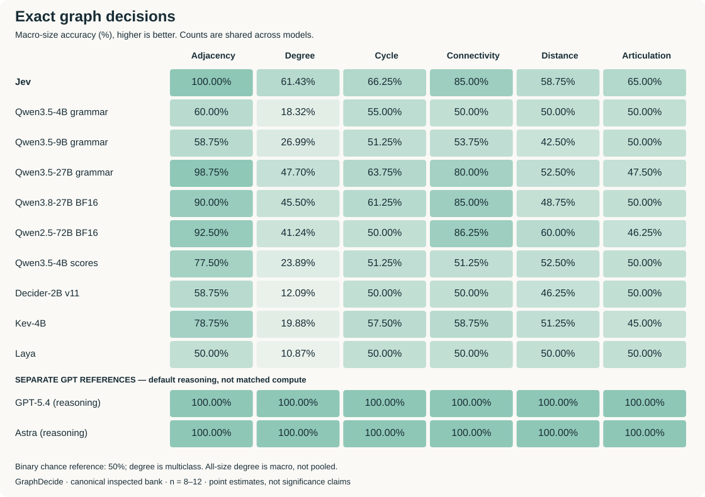
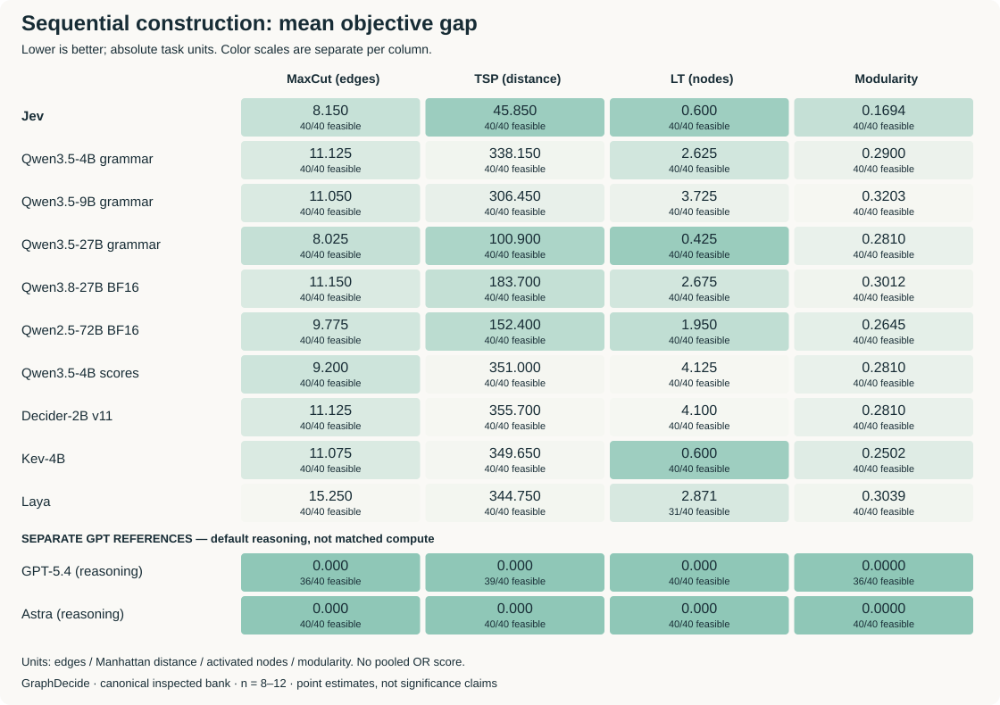

# GraphDecide results

Twelve configurations, ten tasks, 960 shared instances. These are inspected-bank point estimates, not a universal ranking.

## Exact decisions

| Configuration | Adjacency | Degree | Cycle | Connectivity | Distance | Articulation |
|---|---:|---:|---:|---:|---:|---:|
| Jev | 100.00% | 61.43% | 66.25% | 85.00% | 58.75% | 65.00% |
| Qwen3.5-4B grammar | 60.00% | 18.32% | 55.00% | 50.00% | 50.00% | 50.00% |
| Qwen3.5-9B grammar | 58.75% | 26.99% | 51.25% | 53.75% | 42.50% | 50.00% |
| Qwen3.5-27B grammar | 98.75% | 47.70% | 63.75% | 80.00% | 52.50% | 47.50% |
| Qwen3.8-27B BF16 | 90.00% | 45.50% | 61.25% | 85.00% | 48.75% | 50.00% |
| Qwen2.5-72B BF16 | 92.50% | 41.24% | 50.00% | 86.25% | 60.00% | 46.25% |
| Qwen3.5-4B scores | 77.50% | 23.89% | 51.25% | 51.25% | 52.50% | 50.00% |
| Decider-2B v11 | 58.75% | 12.09% | 50.00% | 50.00% | 46.25% | 50.00% |
| Kev-4B | 78.75% | 19.88% | 57.50% | 58.75% | 51.25% | 45.00% |
| Laya | 50.00% | 10.87% | 50.00% | 50.00% | 50.00% | 50.00% |
| GPT-5.4 (reasoning) | 100.00% | 100.00% | 100.00% | 100.00% | 100.00% | 100.00% |
| Astra (reasoning) | 100.00% | 100.00% | 100.00% | 100.00% | 100.00% | 100.00% |

Accuracy averages the five size-specific rates equally. Degree has 400 queries; other exact tasks have 80 each. The two GPT rows use different reasoning budgets.

## Construction gaps

| Configuration | MaxCut (edges) | TSP (distance) | LT (nodes) | Modularity |
|---|---:|---:|---:|---:|
| Jev | 8.1500 (40/40) | 45.8500 (40/40) | 0.6000 (40/40) | 0.1694 (40/40) |
| Qwen3.5-4B grammar | 11.1250 (40/40) | 338.1500 (40/40) | 2.6250 (40/40) | 0.2900 (40/40) |
| Qwen3.5-9B grammar | 11.0500 (40/40) | 306.4500 (40/40) | 3.7250 (40/40) | 0.3203 (40/40) |
| Qwen3.5-27B grammar | 8.0250 (40/40) | 100.9000 (40/40) | 0.4250 (40/40) | 0.2810 (40/40) |
| Qwen3.8-27B BF16 | 11.1500 (40/40) | 183.7000 (40/40) | 2.6750 (40/40) | 0.3012 (40/40) |
| Qwen2.5-72B BF16 | 9.7750 (40/40) | 152.4000 (40/40) | 1.9500 (40/40) | 0.2645 (40/40) |
| Qwen3.5-4B scores | 9.2000 (40/40) | 351.0000 (40/40) | 4.1250 (40/40) | 0.2810 (40/40) |
| Decider-2B v11 | 11.1250 (40/40) | 355.7000 (40/40) | 4.1000 (40/40) | 0.2810 (40/40) |
| Kev-4B | 11.0750 (40/40) | 349.6500 (40/40) | 0.6000 (40/40) | 0.2502 (40/40) |
| Laya | 15.2500 (40/40) | 344.7500 (40/40) | 2.8710 (31/40) | 0.3039 (40/40) |
| GPT-5.4 (reasoning) | 0.0000 (36/40) | 0.0000 (39/40) | 0.0000 (40/40) | 0.0000 (36/40) |
| Astra (reasoning) | 0.0000 (40/40) | 0.0000 (40/40) | 0.0000 (40/40) | 0.0000 (40/40) |

Each cell is **mean gap (feasible/scheduled)**. Gap = solution minus optimum for TSP, optimum minus solution otherwise. Means condition on feasible completion; units differ and must not be pooled. SVG gap colors are scaled independently per column.

## Interpretation and scope

- Jev's perfect adjacency does not imply reliable counting or structural reasoning.
- Jev has smaller construction gaps than both added Qwen3.8-27B and Qwen2.5-72B configurations. Qwen3.5-27B still has smaller MaxCut and LT gaps than Jev; Kev ties Jev on LT at 0.600.
- Qwen2.5-72B is older-generation, not a scale-only ablation. All Qwen grammar rows use bounded direct answers, not full reasoning capacity.
- Laya retains nine unsupported LT inputs; GPT-5.4 retains nine construction timeouts. Zero conditional gap is not zero failure rate.
- Only the original four configurations received prospective new-graph confirmation. The twelve-model rankings have no full fresh-graph replication.
- Original classical references achieve MaxCut gap 0.450 and TSP gap 0.200; uniform legal MaxCut has expected gap 5.325 versus Jev's 8.150. Neural relative advantages do not establish solver competitiveness. These references are not matched-budget online models.

## Source

[Public JSON](../web/data/benchmark.json) · [CSV](../web/data/benchmark.csv)

JSON SHA-256: `e00fac08430afb1d11ec21a58ede8bd0537a0e2bf874022ad5d7f5f2409f8616`. Figures and tables are generated without inference by `python scripts/render_readme_results.py`; use `--check` to detect stale files.
